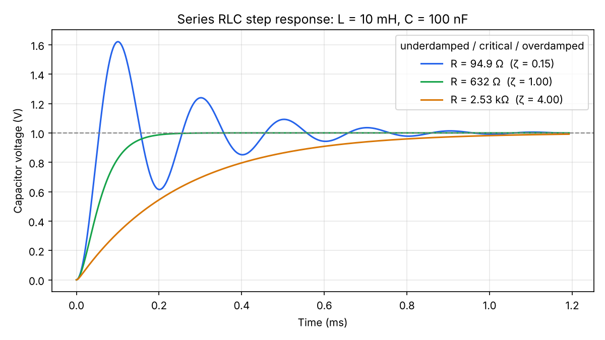

# circuitkit ⚡


A fully tested Python toolkit for the circuit calculations that come up constantly in electrical engineering. It covers DC basics, RC/RL/RLC circuits, complex AC impedance, op-amp design and standard resistor values. It works as a **library** and as a **command-line tool**, and accepts real-world values like `4.7k`, `100n` or `10mH`.



## Features

| Area | What it does |
|---|---|
| **DC basics** | Ohm's law and power from any two of V, I, R; series and parallel resistors; voltage dividers |
| **RC filters** | Time constant, −3 dB cutoff, gain (linear and dB) and phase for low-pass and high-pass; capacitor charging |
| **RL circuits** | Time constant, cutoff frequency, inductor current after a step |
| **RLC circuits** | Resonant frequency, Q factor, bandwidth, damping ratio and type (series or parallel), critical resistance, analytic step response |
| **AC impedance** | Complex impedance of R, L and C; series/parallel combinations; magnitude and phase; phasor current |
| **Standard resistors** | E12 and E24 values, nearest real part, best resistor pair for a target ratio |
| **Op-amps** | Inverting and non-inverting gain, rail clipping, and automatic design with real E12/E24 resistors |
| **Units** | Parse `2.2MΩ`, `100nF`, `10mH`; print results like `4.7 kΩ` |

51 unit tests run automatically on every push with GitHub Actions.

## Install

```bash
git clone https://github.com/abdulrafay338444-droid/circuit-kit.git
cd circuit-kit
pip install -e ".[dev,plot]"
```

## Command line

```console
$ circuitkit ohm -v 9 -r 330
V = 9 V
I = 27.3 mA
R = 330 Ω
P = 245 mW

$ circuitkit rc 1k 1u -f 1k
tau = 1 ms
f_c = 159 Hz
At 1 kHz (lowpass): gain -16.07 dB, phase -81.0°

$ circuitkit rlc 10 10m 100n
f0   = 5.03 kHz
Q    = 31.6
BW   = 159 Hz
zeta = 0.0158 (underdamped)
R for critical damping = 632 Ω

$ circuitkit impedance -f 1k -r 1k -l 10m -c 1u
Z = 1000 - j96.32 Ω
|Z| = 1 kΩ at -5.5°

$ circuitkit nearest 4.6k
4.7 kΩ (+2.2% from target)

$ circuitkit opamp 10 --series E24
Rf = 18 kΩ, Rg = 2 kΩ
gain = 10 (20.00 dB), error +0.00%
```

Other commands: `series`, `parallel`, `divider`, `rl`. Run `circuitkit <command> --help` for options.

## As a library

```python
from circuitkit import parse, impedance, rlc, opamp, eseries

# Series RLC at resonance: L and C cancel, only R is left
l, c = parse("10mH"), parse("100nF")
f0 = rlc.resonant_frequency(l, c)                   # ≈ 5.03 kHz
z = impedance.z_series([
    impedance.z_resistor(10),
    impedance.z_inductor(l, f0),
    impedance.z_capacitor(c, f0),
])
print(impedance.polar(z))                           # (10.0, ~0°)

# Design a gain-of-10 amplifier from parts you can actually buy
print(opamp.design(10, "non-inverting", series="E24"))
# {'rf': 18000.0, 'r_other': 2000.0, 'gain': 10.0, 'error_percent': 0.0}

print(eseries.nearest(5000))                        # 4700.0
```

## Plots

```bash
python examples/bode_plot.py            # RC filter Bode plot (1 kΩ, 1 µF)
python examples/bode_plot.py 4.7k 33n   # your own R and C
python examples/rlc_step.py             # RLC step response, 3 damping cases
python examples/rlc_step.py 1m 1u       # your own L and C
```


## Tests

```bash
pytest
```

## Project layout

```
src/circuitkit/
  basics.py     Ohm's law, power, series/parallel, dividers
  filters.py    RC time constant, cutoff, gain, phase, charging
  rlc.py        RL circuits, RLC resonance, Q, damping, step response
  impedance.py  complex AC impedance
  eseries.py    E12/E24 standard resistor values
  opamp.py      op-amp gain stages and design
  units.py      SI prefix parsing and formatting
  cli.py        command-line interface
tests/          pytest suite
examples/       Bode plot and RLC step-response scripts
```

## Roadmap

- [x] RL and RLC (second-order) circuits
- [x] AC impedance with complex numbers
- [x] Standard E12/E24 resistor value picker
- [x] Op-amp gain stages (inverting / non-inverting)
- [ ] Thevenin/Norton equivalents
- [ ] Nodal analysis solver for small resistor networks
- [ ] Diode and LED current-limiting resistor calculator
- [ ] 555 timer astable/monostable calculator

## License

MIT
