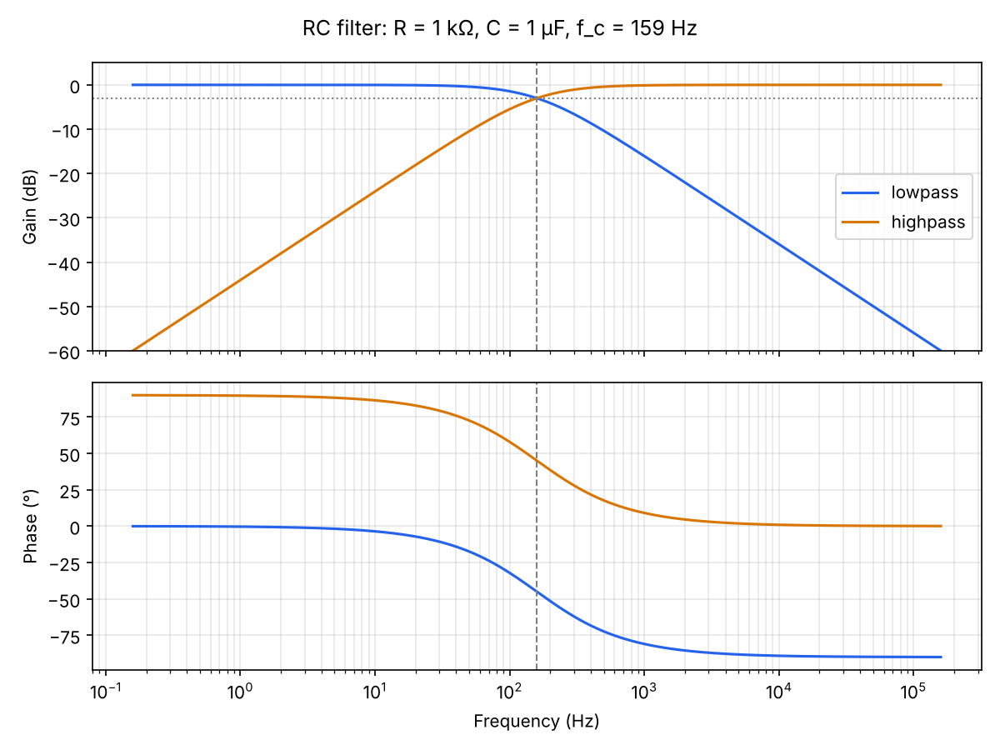

# circuitkit ⚡


A small, fully tested Python toolkit for the circuit calculations that come up constantly in electrical engineering: Ohm's law, resistor networks, voltage dividers and first-order RC filters. It works as a **library** and as a **command-line tool**, and accepts real-world values like `4.7k`, `100n` or `10uF`.



## Features

- **Ohm's law & power**: give any two of V, I, R and get the rest
- **Resistor networks**: series and parallel equivalents
- **Voltage dividers**
- **RC filters**: time constant, −3 dB cutoff, gain (linear and dB) and phase for low-pass and high-pass, plus capacitor charging curves
- **Engineering notation**: parse `2.2MΩ` and print `4.7 kΩ`
- **Bode plot example** using matplotlib
- 21 unit tests, run automatically on every push with GitHub Actions

## Install

```bash
git clone https://github.com/abdulrafay338444-droid/circuit-kit.git
cd circuit-kit
pip install -e ".[dev,plot]"
```

## Command line

```console
$ circuitkit ohm -v 9 -r 330
V = 9 V
I = 27.3 mA
R = 330 Ω
P = 245 mW

$ circuitkit parallel 4.7k 10k
3.2 kΩ

$ circuitkit divider 5 10k 4.7k
Vout = 1.6 V

$ circuitkit rc 1k 1u -f 1k
tau = 1 ms
f_c = 159 Hz
At 1 kHz (lowpass): gain -16.07 dB, phase -81.0°
```

Run `circuitkit --help` to see every command.

## As a library

```python
from circuitkit import cutoff_frequency, gain_db, parallel, parse

r = parallel([parse("10k"), parse("10k")])   # 5000.0
fc = cutoff_frequency(r, parse("100n"))      # ≈ 318 Hz
print(gain_db(fc, r, parse("100n")))         # ≈ -3.01 dB
```

## Bode plot

```bash
python examples/bode_plot.py            # 1 kΩ, 1 µF
python examples/bode_plot.py 4.7k 33n   # your own values
```

## Tests

```bash
pytest
```

## Project layout

```
src/circuitkit/
  basics.py    Ohm's law, power, series/parallel, dividers
  filters.py   RC time constant, cutoff, gain, phase, charging
  units.py     SI prefix parsing and formatting
  cli.py       command-line interface
tests/         pytest suite
examples/      Bode plot script
```

## Roadmap

- [ ] RL and RLC (second-order) circuits
- [ ] AC impedance with complex numbers
- [ ] Standard E12/E24 resistor value picker
- [ ] Op-amp gain stages (inverting / non-inverting)

## License

MIT
